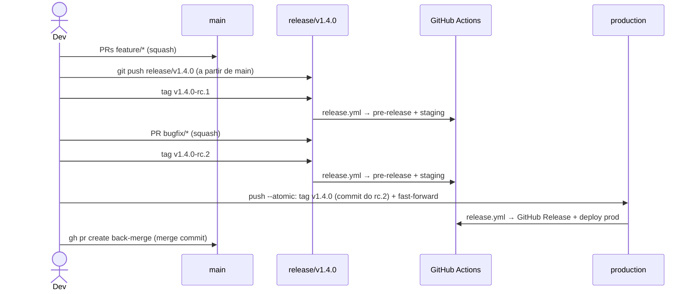

# 03 — Release Branch Strategy e Tags

Produção recebe **releases empacotadas e versionadas**. Toda automação de entrega é disparada por **tags**.

## Versionamento

[SemVer 2.0.0](https://semver.org/lang/pt-BR/) com prefixo `v`.

| Tag                | Significado                     | Dispara                                       |
|--------------------|---------------------------------|-----------------------------------------------|
| `vX.Y.Z-rc.N`      | Release candidate N da versão   | build do pacote, pre-release, deploy staging  |
| `vX.Y.Z`           | Versão final, em produção       | build, atestação, GitHub Release, deploy prod |

Regras de tag:

- Sempre **anotadas** (`git tag -a`), nunca leves. O workflow rejeita tags leves.
- **Imutáveis**: não podem ser movidas nem apagadas (ruleset de tags).
- Criadas **pelo mantenedor** com `git tag -a` + `git push origin <tag>`; o push da tag dispara o `release.yml`.
- A versão é **calculada** a partir dos commits desde a última tag final (`git cliff --bumped-version`):
  - existe `!`/`BREAKING CHANGE` → major
  - existe `feat` → minor
  - caso contrário → patch

## Fluxo regular

Comandos completos em [05-automacao.md](05-automacao.md#uso-diario).

### 1. Corte da release

- Calcule a próxima versão localmente com `git cliff --bumped-version` e compare com a última tag final.
- Crie `release/vX.Y.Z` a partir do HEAD de `origin/main` e faça push.
- A partir daqui, `main` segue recebendo features normalmente — elas vão para a **próxima** release.

### 2. Estabilização — tags RC

- Todo push em `release/v*` roda o CI (`ci.yml`).
- Com o CI verde, crie a tag `vX.Y.Z-rc.N` (N incremental) no HEAD da release.
- A tag RC dispara `release.yml`: CI, pacote, **pre-release** e deploy em **staging**.
- Na release só entram correções (`bugfix/*`, `hotfix/*`, `chore/*`) via PR. **Nenhuma feature nova.** Cada correção mergeada pede um novo RC.

### 3. Promoção — tag final

- Crie a tag anotada `vX.Y.Z` **no mesmo commit do último RC** e atualize `production` por fast-forward, em um único `git push --atomic`.
- O ruleset de `production` bloqueia force push: se `production` não for ancestral da release, o push é recusado.

### 4. Publicação — `release.yml` (tag final)

- Valida antes de publicar:
  - a tag é anotada e aponta para o HEAD de `production`;
  - a tag está no commit do **último RC** da versão;
  - o pre-release desse RC existe (build concluído).
- Roda o CI, gera o pacote, a **atestação de proveniência** (SLSA) e o GitHub Release com changelog.
- Deploy no Environment `production` (com aprovação, se o Environment tiver *required reviewers*).

### 5. Back-merge

- Abra o PR `release/vX.Y.Z → main` com `gh pr create` e faça merge por **merge commit** (pule se a release não tiver commits novos).
- O PR é aberto por você (não pelo `GITHUB_TOKEN`) para que os checks obrigatórios rodem.

## Fluxo de hotfix

Mesmo pipeline; muda apenas a origem da release e o bump.

1. Crie `release/vX.Y.(Z+1)` a partir de `origin/production` e faça push.
2. Crie `hotfix/descricao` a partir dessa release e abra PR para ela.
3. Merge → tag `vX.Y.(Z+1)-rc.1` → staging → validação.
4. Tag `vX.Y.(Z+1)` + fast-forward de `production` → produção.
5. Back-merge para `main` leva o hotfix ao desenvolvimento.

> Se uma release regular estiver em andamento durante o hotfix, após o back-merge do hotfix em `main`, aplique a correção também na release aberta (cherry-pick em `bugfix/*` com PR para ela). Caso contrário a promoção da release regular será recusada por `production` não ser ancestral — o que é o comportamento desejado: impede regressão do hotfix.

## Pacotes

- O pacote é gerado a partir do **commit da tag**; como a tag final aponta para o mesmo commit do último RC, o código publicado é **idêntico** ao validado em staging.
- Cada pacote recebe atestação (`actions/attest-build-provenance`) verificável com `gh attestation verify`.
- Para imagens de container, prefira **promover o digest** do RC (re-tag `X.Y.Z-rc.N` → `X.Y.Z`) em vez de rebuild — build once, deploy many.

## Rollback

- Rollback = **nova release**, nunca mover `production` para trás nem apagar tags.
- Opção rápida: redeploy do pacote de uma tag anterior (`workflow_dispatch` no deploy, apenas com tags `v*` existentes).
- Correção definitiva: `revert:` em `main` ou hotfix, seguindo o fluxo normal.

## Changelog

Gerado por [git-cliff](https://git-cliff.org) a partir dos Conventional Commits ([`cliff.toml`](https://github.com/uesleinasch/ConventionsCode/blob/main/GitFlow/templates/cliff.toml)). Fica no corpo do GitHub Release; não é commitado no repositório, evitando commits extras nas branches protegidas.
