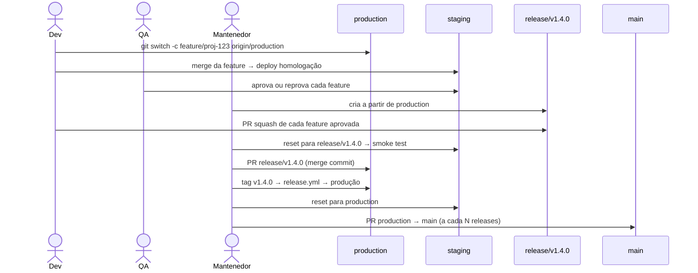

# 03 — Release Branch Strategy e Tags

Produção recebe **releases seletivas e versionadas**: só as features aprovadas entram, cada uma como um commit, e cada publicação ganha uma tag `vX.Y.Z` que dispara o pacote e o deploy.

## Versionamento

[SemVer 2.0.0](https://semver.org/lang/pt-BR/) com prefixo `v`.

| Tag       | Significado                  | Dispara                                       |
|-----------|------------------------------|-----------------------------------------------|
| `vX.Y.Z`  | Versão publicada em produção | CI, pacote, atestação, GitHub Release, deploy em produção |

Regras de tag:

- Sempre **anotadas** (`git tag -a`), nunca leves. O workflow rejeita tags leves.
- **Imutáveis**: não podem ser movidas nem apagadas (ruleset de tags).
- Criadas no commit de `production` resultante do merge da release (ou do hotfix), depois do merge.
- Sempre maiores que a versão anterior; o `release.yml` recusa a publicação caso contrário.
- O nível do bump segue os commits que entraram (confira com `git cliff --bumped-version` na release antes de publicar):
  - existe `!`/`BREAKING CHANGE` → major
  - existe `feat` → minor
  - caso contrário → patch

## Fluxo regular

Comandos completos em [05-automacao.md](05-automacao.md#uso-diario).

### 1. Desenvolvimento

- A branch nasce de `production`: `git switch -c feature/proj-123-descricao origin/production`.
- Quantos commits quiser: o squash na release junta tudo em um.
- Se `production` avançou (outra release ou hotfix), sincronize com `git rebase origin/production`. **Nunca** `git merge staging`: isso traz features alheias, inclusive reprovadas, e impede a entrega seletiva.

### 2. Teste em homologação (opcional)

- Merge normal da feature em `staging` e push → o workflow `staging.yml` roda o CI e faz deploy em homologação.
- `staging` pode ter várias features ao mesmo tempo; a branch da feature continua limpa.
- QA aprova ou reprova cada feature. Reprovadas são corrigidas na própria branch e mergeadas de novo em `staging`.

### 3. Corte da release

- O mantenedor cria `release/vX.Y.Z` a partir de `origin/production`, escolhendo a versão pelos commits esperados.
- A release nasce limpa: mesmo conteúdo de produção.

### 4. Features aprovadas entram por squash

- Cada feature aprovada abre PR para `release/vX.Y.Z` com **squash**. O título do PR vira o commit: `feat(proj-123): descrição`.
- Features reprovadas não abrem PR e não entram.
- Para tirar uma feature que já entrou: `git revert <commit-do-squash>` na release (um commit por feature torna isso cirúrgico).

### 5. Validação final

- Com homologação: `staging` é resetada para o estado exato da release (`git push --force-with-lease origin origin/release/vX.Y.Z:staging`) e passa por smoke test do conjunto.
- Sem homologação: o CI da release (`ci.yml` em push de `release/v*`) é a validação.

### 6. Publicação

- PR `release/vX.Y.Z → production` com **merge commit**. Pipeline e aprovações obrigatórias pelo ruleset.
- Após o merge, tag anotada `vX.Y.Z` no HEAD de `production` e push da tag.
- O `release.yml` valida (tag anotada, contida em `production`, maior que a anterior), roda o CI, gera o pacote, a **atestação de proveniência** (SLSA) e o GitHub Release com changelog, e faz o deploy no Environment `production`.
- A branch `release/vX.Y.Z` é removida.

### 7. Limpeza pós-publicação

- `staging` é resetada para `production` (`git push --force-with-lease origin origin/production:staging`): toda a contaminação acumulada some e o próximo ciclo começa igual à produção. Features em teste que não entraram são mergeadas de novo em `staging` por quem as desenvolve.
- A cada **N releases publicadas** (padrão 2), PR `production → main` com merge commit. É o único caminho até `main`, e o `pr-checks.yml` só aceita quando o HEAD de `production` tem tag `vX.Y.Z`. O `release.yml` avisa (job `main-sync-reminder`) quando o intervalo é atingido.

## Fluxo de hotfix

Correção urgente não passa pela release nem por `staging` antes de produção.

1. `hotfix/descricao` nasce de `origin/production`.
2. PR para `production` com **squash**; pipeline e aprovações obrigatórias.
3. Após o merge, tag de patch `vX.Y.(Z+1)` → `release.yml` → produção.
4. Leve o fix para `staging` por `git cherry-pick <commit-do-squash>` (se houver homologação).
5. Se houver uma `release/*` aberta, leve o fix para ela também: `bugfix/*` a partir de `production` (que já contém o hotfix) com PR squash para a release.
6. O hotfix conta como release publicada para o intervalo do backup em `main` (passo 7 do fluxo regular).

## Pacotes

- O pacote é gerado a partir do **commit da tag**, em `production`.
- Cada pacote recebe atestação (`actions/attest-build-provenance`) verificável com `gh attestation verify`.
- Homologação usa pacotes próprios (`staging-<sha>`), gerados a cada push em `staging`.

## Rollback

- **Versão completa (recomendado):** redeploy do pacote de uma tag anterior (`workflow_dispatch` no deploy, apenas com tags `v*` existentes). Sem commits, sem mover tags.
- **Uma feature só:** como cada feature é um commit, `git revert <commit-do-squash>` em `hotfix/*` com PR para `production`, seguindo o fluxo de hotfix.
- Nunca mover `production` para trás nem apagar tags.

## Changelog

Gerado por [git-cliff](https://git-cliff.org) a partir dos Conventional Commits ([`cliff.toml`](https://github.com/uesleinasch/ConventionsCode/blob/main/GitFlow/templates/cliff.toml)). Fica no corpo do GitHub Release; não é commitado no repositório, evitando commits extras nas branches protegidas.
