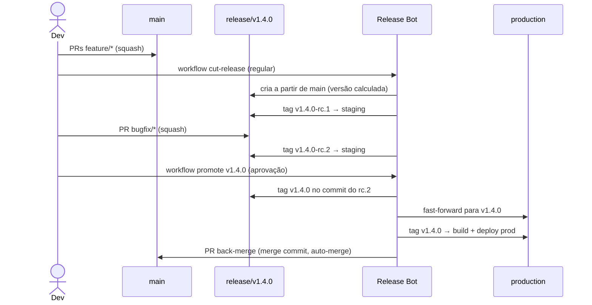

# 03 — Release Branch Strategy e Tags

Produção recebe **releases empacotadas e versionadas**. Toda automação de entrega é disparada por **tags**.

## Versionamento

[SemVer 2.0.0](https://semver.org/lang/pt-BR/) com prefixo `v`.

| Tag                | Significado                     | Dispara                                       |
|--------------------|---------------------------------|-----------------------------------------------|
| `vX.Y.Z-rc.N`      | Release candidate N da versão   | build do pacote, pre-release, deploy staging  |
| `vX.Y.Z`           | Versão final, em produção       | build, atestação, GitHub Release, deploy prod |

Regras de tag:

- Sempre **anotadas** (`git tag -a`), nunca leves. O workflow rejeita tags leves.
- **Imutáveis**: não podem ser movidas nem apagadas (ruleset de tags).
- Criadas **somente pelo bot de release**.
- A versão é **calculada** a partir dos commits desde a última tag final:
  - existe `!`/`BREAKING CHANGE` → major
  - existe `feat` → minor
  - caso contrário → patch

## Fluxo regular

### 1. Corte da release — `cut-release`

- Executado manualmente (`workflow_dispatch`, tipo `regular`).
- Calcula a próxima versão com `git-cliff --bumped-version`.
- Falha se não houver commits relevantes ou se `release/vX.Y.Z` já existir.
- Cria `release/vX.Y.Z` a partir do HEAD de `main`.
- A partir daqui, `main` segue recebendo features normalmente — elas vão para a **próxima** release.

### 2. Estabilização — `release-candidate`

- Todo push em `release/v*` roda o CI e cria a tag `vX.Y.Z-rc.N` (N incremental).
- A tag RC dispara `release.yml`: pacote gerado, publicado como **pre-release** e implantado em **staging**.
- Na release só entram correções (`bugfix/*`, `hotfix/*`, `chore/*`) via PR. **Nenhuma feature nova.**

### 3. Promoção — `promote`

- Executado manualmente informando a versão (`v1.4.0`).
- Exige **aprovação** no Environment `release-approval` (registro de quem aprovou e quando).
- Validações antes de promover:
  - a versão ainda não tem tag final;
  - o HEAD de `release/vX.Y.Z` é exatamente o commit do **último RC**;
  - o pre-release desse RC existe (build concluído);
  - `production` é ancestral do HEAD da release (fast-forward possível).
- Cria a tag anotada `vX.Y.Z` **no mesmo commit do RC** e atualiza `production` por fast-forward, em um único `git push --atomic`.

### 4. Publicação — `release` (tag final)

- Verifica que a tag é anotada e aponta para o HEAD de `production`.
- Gera o pacote, a **atestação de proveniência** (SLSA) e o GitHub Release com changelog.
- Deploy no Environment `production`.
- Abre o PR de **back-merge** `release/vX.Y.Z → main` com auto-merge por **merge commit** (pulado se não houver commits novos na release).

## Fluxo de hotfix

Mesmo pipeline; muda apenas a origem da release e o bump.

1. `cut-release` com tipo `hotfix` → cria `release/vX.Y.(Z+1)` a partir de `production`.
2. Dev cria `hotfix/descricao` a partir dessa release e abre PR para ela.
3. Merge → `vX.Y.(Z+1)-rc.1` → staging → validação.
4. `promote vX.Y.(Z+1)` → produção.
5. Back-merge para `main` leva o hotfix ao desenvolvimento.

> Se uma release regular estiver em andamento durante o hotfix, após o back-merge do hotfix em `main`, aplique a correção também na release aberta (cherry-pick em `bugfix/*` com PR para ela). Caso contrário o `promote` da release regular falhará por `production` não ser ancestral — o que é o comportamento desejado: impede regressão do hotfix.

## Pacotes

- O pacote é gerado a partir do **commit da tag**; como a tag final aponta para o mesmo commit do último RC, o código publicado é **idêntico** ao validado em staging.
- Cada pacote recebe atestação (`actions/attest-build-provenance`) verificável com `gh attestation verify`.
- Para imagens de container, prefira **promover o digest** do RC (re-tag `X.Y.Z-rc.N` → `X.Y.Z`) em vez de rebuild — build once, deploy many.

## Rollback

- Rollback = **nova release**, nunca mover `production` para trás nem apagar tags.
- Opção rápida: redeploy do pacote de uma tag anterior (`workflow_dispatch` no deploy, apenas com tags `v*` existentes).
- Correção definitiva: `revert:` em `main` ou hotfix, seguindo o fluxo normal.

## Changelog

Gerado por [git-cliff](https://git-cliff.org) a partir dos Conventional Commits ([`cliff.toml`](templates/cliff.toml)). Fica no corpo do GitHub Release; não é commitado no repositório, evitando commits de bot nas branches protegidas.
