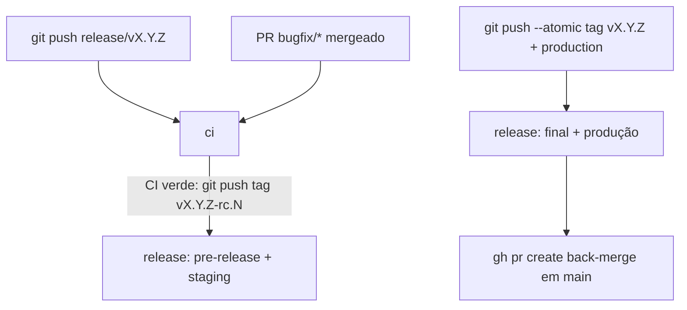

# 05 — Automação

Workflows em [`templates/.github/workflows/`](https://github.com/uesleinasch/ConventionsCode/tree/main/GitFlow/templates/.github/workflows). A entrega é dirigida por **tags**: o mantenedor cria branches e tags com `git`/`gh`, e o GitHub Actions reage ao push. Nenhum workflow cria refs, então não há bot, GitHub App nem secret de release.

## Mapa dos workflows

| Workflow         | Gatilho                                              | O que faz                                                              |
|------------------|------------------------------------------------------|------------------------------------------------------------------------|
| `pr-checks.yml`  | `pull_request`                                       | Valida nome da branch × destino e título do PR (Conventional Commits) |
| `ci.yml`         | `pull_request`, push `main`/`release/v*`, `workflow_call` | Lint e testes                                                     |
| `security.yml`   | `pull_request`, push `main`, semanal                 | Dependency review e CodeQL                                             |
| `release.yml`    | push de tag `v*`                                     | Validação da tag, CI, pacote, atestação, GitHub Release, deploy        |



## Pontos de customização

Os templates usam alvos genéricos que cada projeto implementa:

| Placeholder                       | Onde                    | Esperado                                 |
|-----------------------------------|-------------------------|------------------------------------------|
| `make lint` / `make test`         | `ci.yml`                | Lint e testes do projeto                 |
| `make package VERSION=...`        | `release.yml`           | Gera artefatos em `dist/`                |
| `./scripts/deploy.sh <env> dist/` | `release.yml`           | Deploy do pacote no ambiente             |
| `languages:`                      | `security.yml` (CodeQL) | Linguagens do projeto                    |

## Setup do repositório (checklist)

1. **Ferramentas locais**
   - [ ] `gh` autenticado (`gh auth status`) com papel Admin ou Maintain no repositório.
   - [ ] [`git-cliff`](https://git-cliff.org/docs/installation) instalado (cálculo da versão).
   - [ ] Assinatura de commits e tags configurada ([04-seguranca.md](04-seguranca.md#assinatura)).
2. **Branches**
   - [ ] `main` como default; criar `production` a partir do commit da última versão em produção e taguear `vX.Y.Z` (ou `v0.1.0`).
   - [ ] *Automatically delete head branches* ligado.
   - [ ] Squash com *Default to pull request title*; merge commit habilitado; rebase desabilitado.
   - [ ] *Allow auto-merge* habilitado (back-merge com `gh pr merge --auto`).
3. **Rulesets** — conforme [04-seguranca.md](04-seguranca.md), com o papel do mantenedor no bypass.
4. **Environments** — `staging`, `production`.
5. **Actions**
   - [ ] Permissões padrão do `GITHUB_TOKEN`: read.
   - [ ] Copiar `templates/.github/` e `templates/cliff.toml` para o projeto.
   - [ ] Trocar refs de actions por SHA.
6. **Code security** — secret scanning, push protection, Dependabot alerts.
7. **Teste de fumaça**
   - [ ] PR `feature/teste-fluxo` com título `feat: teste do fluxo` → merge.
   - [ ] Corte de `release/v0.x.0` e tag `v0.x.0-rc.1` → pre-release e deploy em staging.
   - [ ] Promoção `v0.x.0` → `production` atualizada, GitHub Release, deploy, back-merge.

## Uso diário

Desenvolvimento:

```bash
git switch main && git pull
git switch -c feature/issue-42-export-csv
git commit -m "feat(report): adiciona exportação em CSV"
git push -u origin feature/issue-42-export-csv
gh pr create --base main --title "feat(report): adiciona exportação em CSV"
```

### Corte da release

```bash
git switch main && git pull && git fetch origin --tags
last=$(git describe --tags --abbrev=0 --match 'v[0-9]*' --exclude '*-rc.*' 2>/dev/null || echo v0.0.0)
next=$(git cliff --bumped-version)
echo "$last → $next"
git push origin "origin/main:refs/heads/release/$next"
```

Se `next` for igual a `last`, não há commits relevantes para uma nova versão.

### Release candidate

Depois de cada push na release (corte ou PR de correção mergeado), com o CI verde:

```bash
VERSION=v1.4.0
gh run list --workflow ci.yml --branch "release/$VERSION" --limit 1
git fetch origin --tags
n=$(git tag -l "$VERSION-rc.*" | wc -l)
rc="$VERSION-rc.$((n + 1))"
git tag -a "$rc" "origin/release/$VERSION" -m "Release candidate $rc"
git push origin "$rc"
gh run watch
```

### Promoção para produção

Depois de validar o último RC em staging:

```bash
VERSION=v1.4.0
git fetch origin --tags
rc=$(git tag -l "$VERSION-rc.*" --sort=-v:refname | head -n1)
commit=$(git rev-list -n1 "$rc")
[ "$commit" = "$(git rev-parse "origin/release/$VERSION")" ] || echo "release/$VERSION tem commits sem RC; gere um novo RC antes."
git tag -a "$VERSION" "$commit" -m "Release $VERSION (promovida de $rc)"
git push --atomic origin "$commit:refs/heads/production" "refs/tags/$VERSION"
gh run watch
```

O `--atomic` garante que a tag e `production` sobem juntas ou nenhuma sobe. Se o push for recusado por não ser fast-forward, `production` recebeu um hotfix que a release ainda não tem.

### Back-merge

```bash
gh pr create --base main --head "release/$VERSION" \
  --title "chore(release): back-merge $VERSION" \
  --body "Back-merge de release/$VERSION. Merge commit, nunca squash."
gh pr merge "release/$VERSION" --merge --auto
```

### Hotfix

```bash
git fetch origin --tags
last=$(git describe --tags --abbrev=0 --match 'v[0-9]*' --exclude '*-rc.*' origin/production)
IFS=. read -r major minor patch <<< "${last#v}"
VERSION="v$major.$minor.$((patch + 1))"
git push origin "origin/production:refs/heads/release/$VERSION"

git switch -c hotfix/cve-2026-1234 "origin/release/$VERSION"
git commit -m "fix(auth): corrige validação de token expirado"
git push -u origin hotfix/cve-2026-1234
gh pr create --base "release/$VERSION" --title "fix(auth): corrige validação de token expirado"
```

Após o merge do PR, siga [Release candidate](#release-candidate), [Promoção](#promocao-para-producao) e [Back-merge](#back-merge) com o mesmo `VERSION`.
