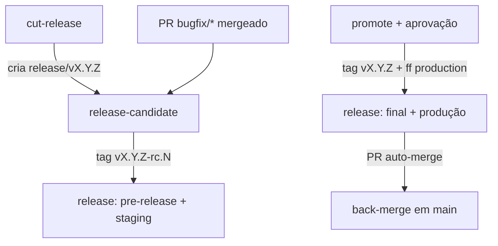

# 05 — Automação

Workflows em [`templates/.github/workflows/`](https://github.com/uesleinasch/ConventionsCode/tree/main/GitFlow/templates/.github/workflows). A cadeia é dirigida por **tags**: cada etapa cria uma ref que dispara a seguinte.

## Mapa dos workflows

| Workflow                 | Gatilho                              | O que faz                                                              |
|--------------------------|--------------------------------------|------------------------------------------------------------------------|
| `pr-checks.yml`          | `pull_request`                       | Valida nome da branch × destino e título do PR (Conventional Commits) |
| `ci.yml`                 | `pull_request`, push `main`, `workflow_call` | Lint e testes                                                  |
| `security.yml`           | `pull_request`, push `main`, semanal | Dependency review e CodeQL                                             |
| `cut-release.yml`        | manual (`regular` \| `hotfix`)       | Calcula versão e cria `release/vX.Y.Z`                                  |
| `release-candidate.yml`  | push em `release/v*`                 | CI + cria tag `vX.Y.Z-rc.N`                                            |
| `promote.yml`            | manual (versão) + aprovação          | Tag final no commit do RC + fast-forward de `production`               |
| `release.yml`            | push de tag `v*`                     | Pacote, atestação, GitHub Release, deploy, back-merge                  |



## Pontos de customização

Os templates usam alvos genéricos que cada projeto implementa:

| Placeholder                       | Onde                    | Esperado                                 |
|-----------------------------------|-------------------------|------------------------------------------|
| `make lint` / `make test`         | `ci.yml`                | Lint e testes do projeto                 |
| `make package VERSION=...`        | `release.yml`           | Gera artefatos em `dist/`                |
| `./scripts/deploy.sh <env> dist/` | `release.yml`           | Deploy do pacote no ambiente             |
| `languages:`                      | `security.yml` (CodeQL) | Linguagens do projeto                    |

## Setup do repositório (checklist)

1. **GitHub App de release**
   - [ ] Criar App com `contents: write` e `pull_requests: write`; instalar no repositório.
   - [ ] `vars.RELEASE_APP_ID`, `vars.RELEASE_BOT_EMAIL` e `secrets.RELEASE_APP_PRIVATE_KEY`.
2. **Branches**
   - [ ] `main` como default; criar `production` a partir do commit da última versão em produção e taguear `vX.Y.Z` (ou `v0.1.0`).
   - [ ] *Automatically delete head branches* ligado.
   - [ ] Squash com *Default to pull request title*; merge commit habilitado; rebase desabilitado.
   - [ ] *Allow auto-merge* habilitado (back-merge).
3. **Rulesets** — conforme [04-seguranca.md](04-seguranca.md).
4. **Environments** — `staging`, `release-approval`, `production`.
5. **Actions**
   - [ ] Permissões padrão do `GITHUB_TOKEN`: read.
   - [ ] Copiar `templates/.github/` e `templates/cliff.toml` para o projeto.
   - [ ] Trocar refs de actions por SHA.
6. **Code security** — secret scanning, push protection, Dependabot alerts.
7. **Teste de fumaça**
   - [ ] PR `feature/teste-fluxo` com título `feat: teste do fluxo` → merge.
   - [ ] `cut-release regular` → `release/v0.x.0` e `v0.x.0-rc.1` em staging.
   - [ ] `promote` → tag final, `production` atualizada, GitHub Release, back-merge.

## Uso diário

```bash
git switch main && git pull
git switch -c feature/issue-42-export-csv
git commit -m "feat(report): adiciona exportação em CSV"
git push -u origin feature/issue-42-export-csv
gh pr create --base main --title "feat(report): adiciona exportação em CSV"
```

Release:

```bash
gh workflow run cut-release.yml -f kind=regular
gh workflow run promote.yml -f version=v1.4.0
```

Hotfix:

```bash
gh workflow run cut-release.yml -f kind=hotfix
git fetch && git switch -c hotfix/cve-2026-1234 origin/release/v1.4.1
gh pr create --base release/v1.4.1 --title "fix(auth): corrige validação de token expirado"
gh workflow run promote.yml -f version=v1.4.1
```
