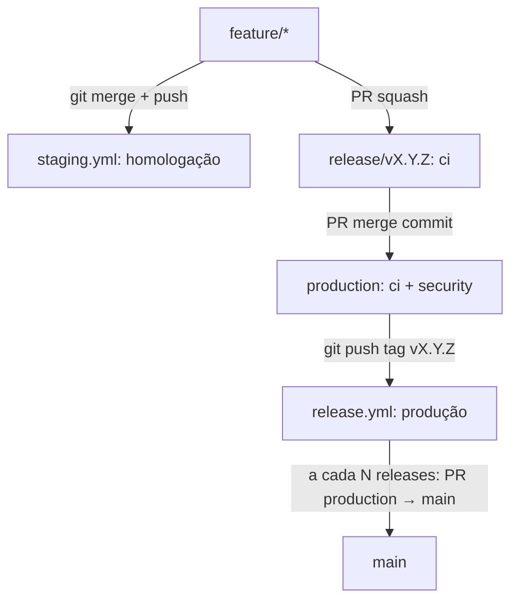

# 05 — Automação

Workflows em [`templates/.github/workflows/`](https://github.com/uesleinasch/ConventionsCode/tree/main/GitFlow/templates/.github/workflows). O mantenedor (ou o agente, quando autorizado) cria branches, PRs e tags com `git`/`gh`; o GitHub Actions reage. Nenhum workflow cria refs, então não há bot, GitHub App nem secret de release.

## Mapa dos workflows

| Workflow         | Gatilho                                         | O que faz                                                              |
|------------------|-------------------------------------------------|------------------------------------------------------------------------|
| `pr-checks.yml`  | `pull_request`                                  | Valida rota origem × destino, título do PR e, em PR para `main`, se o HEAD de `production` é uma versão publicada |
| `ci.yml`         | `pull_request`, push `production`/`release/v*`, `workflow_call` | Lint e testes                                     |
| `security.yml`   | `pull_request`, push `production`, semanal      | Dependency review e CodeQL                                             |
| `staging.yml`    | push em `staging`                               | CI, pacote `staging-<sha>` e deploy em homologação                     |
| `release.yml`    | push de tag `vX.Y.Z`                            | Validação da tag, CI, pacote, atestação, GitHub Release, deploy em produção e aviso do backup em `main` |



## Pontos de customização

Os templates usam alvos genéricos que cada projeto implementa:

| Placeholder                       | Onde                          | Esperado                                 |
|-----------------------------------|-------------------------------|------------------------------------------|
| `make lint` / `make test`         | `ci.yml`                      | Lint e testes do projeto                 |
| `make package VERSION=...`        | `release.yml`, `staging.yml`  | Gera artefatos em `dist/`                |
| `./scripts/deploy.sh <env> dist/` | `release.yml`, `staging.yml`  | Deploy do pacote no ambiente             |
| `languages:`                      | `security.yml` (CodeQL)       | Linguagens do projeto                    |

Sem homologação, apague `staging.yml` e o Environment `staging`.

## Setup do repositório (checklist)

1. **Ferramentas locais**
   - [ ] `gh` autenticado (`gh auth status`); o mantenedor com papel Admin ou Maintain.
   - [ ] [`git-cliff`](https://git-cliff.org/docs/installation) instalado (conferência do bump).
   - [ ] Assinatura de commits e tags configurada ([04-seguranca.md](04-seguranca.md#assinatura)).
2. **Branches**
   - [ ] `production` a partir do commit que está no ar, com tag `vX.Y.Z` (ou `v0.1.0`). A branch default do repositório pode continuar a mesma.
   - [ ] `main` e, se houver homologação, `staging` criadas a partir de `production`.
   - [ ] Atalho: `/conventions setup gitflow <ref>` cria `production` em `origin` a partir de `<ref>` (só se ela ainda não existir), cria `main` a partir de `production` se faltar e as cópias locais. Sem `<ref>`, só relata e cria as cópias locais. `staging` e a tag inicial continuam manuais.
   - [ ] `dependabot.yml` com `target-branch: production` (já no template).
   - [ ] Squash com *Default to pull request title*; merge commit habilitado; rebase desabilitado.
   - [ ] *Automatically delete head branches* ligado (as permanentes ficam protegidas pelo ruleset de deleção).
3. **Rulesets** — conforme [04-seguranca.md](04-seguranca.md), com o papel do mantenedor no bypass.
4. **Environments** — `production` e, se houver homologação, `staging`.
5. **Actions**
   - [ ] Permissões padrão do `GITHUB_TOKEN`: read.
   - [ ] Copiar `templates/.github/` e `templates/cliff.toml` para o projeto.
   - [ ] Trocar refs de actions por SHA.
6. **Code security** — secret scanning, push protection, Dependabot alerts.
7. **Claude Code** (opcional)
   - [ ] `/conventions enable gitflow` — grava `releaseAgent: true` e `mainSyncEvery: 2` em `.claude/conventions.json`.
   - [ ] Opcional: `/conventions auto on` dá autonomia ao agente (merge de PRs e fluxo de ponta a ponta, parando no primeiro erro). `/conventions auto off` ou `/conventions release off` revogam.
   - [ ] Ajustar o intervalo do backup com `/conventions main-sync <n>` (ou a variável de repositório `MAIN_SYNC_EVERY`, que tem prioridade no `release.yml`).
8. **Teste de fumaça**
   - [ ] `feature/teste-fluxo` → merge em `staging` → deploy de homologação.
   - [ ] `release/v0.x.0` → PR squash da feature → PR para `production` → tag → deploy em produção.
   - [ ] Reset de `staging`; na N-ésima release, PR `production → main`.

## Uso diário

Desenvolvimento:

```bash
git fetch origin
git switch -c feature/proj-123-export-csv origin/production
git commit -m "feat(proj-123): adiciona exportação em CSV"
git push -u origin feature/proj-123-export-csv
```

Atualizar a branch com o que já está em produção (nunca com `staging`):

```bash
git fetch origin
git rebase origin/production
git push --force-with-lease
```

### Teste em homologação

```bash
git fetch origin
git switch staging
git reset --hard origin/staging
git merge --no-ff feature/proj-123-export-csv
git push origin staging
gh run watch
```

### Corte da release

```bash
git fetch origin --tags
git describe --tags --abbrev=0 --match 'v[0-9]*' origin/production
VERSION=v1.4.0
git push origin "origin/production:refs/heads/release/$VERSION"
```

### Feature aprovada na release

```bash
gh pr create --base "release/$VERSION" --head feature/proj-123-export-csv \
  --title "feat(proj-123): adiciona exportação em CSV"
gh pr checks feature/proj-123-export-csv --watch
gh pr merge feature/proj-123-export-csv --squash
```

Para tirar uma feature que já entrou:

```bash
git fetch origin
git log --oneline "origin/production..origin/release/$VERSION"
git switch -c chore/remove-proj-456 "origin/release/$VERSION"
git revert --no-edit <commit-do-squash>
git push -u origin chore/remove-proj-456
gh pr create --base "release/$VERSION" --title "revert: remove proj-456 da release"
```

### Validação final em homologação

```bash
git fetch origin
git push --force-with-lease origin "origin/release/$VERSION:staging"
gh run watch
git cliff --bumped-version "origin/production..origin/release/$VERSION"
```

Se o `git cliff` indicar um bump maior que `$VERSION` (ex.: há `feat` e a release é patch), crie a release com o nome certo antes de publicar.

### Publicação

```bash
gh pr create --base production --head "release/$VERSION" \
  --title "chore(release): publica $VERSION" \
  --body "Merge commit, nunca squash."
gh pr checks "release/$VERSION" --watch
gh pr merge "release/$VERSION" --merge --delete-branch

git fetch origin --tags
git tag -a "$VERSION" origin/production -m "Release $VERSION"
git push origin "$VERSION"
gh run watch
```

### Limpeza pós-publicação

```bash
git fetch origin
git push --force-with-lease origin origin/production:staging
```

Quem tinha features em teste que não entraram faz o merge delas em `staging` de novo. Sem homologação, não há limpeza.

### Backup em `main`

A cada N releases publicadas (padrão 2; hotfix conta), abra o PR `production → main`. O `release.yml` avisa quando o intervalo é atingido.

```bash
git fetch origin --tags
git tag -l 'v[0-9]*' --merged origin/production --no-merged origin/main
gh pr create --base main --head production --title "chore(release): backup estável $VERSION"
gh pr checks production --watch
gh pr merge production --merge
```

### Hotfix

```bash
git fetch origin --tags
git switch -c hotfix/cve-2026-1234 origin/production
git commit -m "fix(auth): corrige validação de token expirado"
git push -u origin hotfix/cve-2026-1234
gh pr create --base production --title "fix(auth): corrige validação de token expirado"
gh pr checks hotfix/cve-2026-1234 --watch
gh pr merge hotfix/cve-2026-1234 --squash --delete-branch

git fetch origin --tags
last=$(git describe --tags --abbrev=0 --match 'v[0-9]*' origin/production)
IFS=. read -r major minor patch <<< "${last#v}"
VERSION="v$major.$minor.$((patch + 1))"
git tag -a "$VERSION" origin/production -m "Hotfix $VERSION"
git push origin "$VERSION"
gh run watch
```

Depois do deploy, leve o fix para `staging` e confira o intervalo do [backup em `main`](#backup-em-main):

```bash
git switch staging && git reset --hard origin/staging
git cherry-pick origin/production
git push origin staging
```

## Execução pelo agente

Por padrão o agente executa os passos acima quando você pede (ex.: "publique a release v1.4.0 com as features proj-123 e proj-456"):

- segue a ordem desta seção, um passo por vez;
- espera cada workflow ou check terminar (`gh run watch`, `gh pr checks --watch`) antes do próximo;
- depois de publicar, confere o intervalo e abre o PR `production → main` quando chegar a vez;
- para no primeiro erro e reporta, sem tentar contornar proteção.

A configuração fica em `.claude/conventions.json`, gravada ao ativar a convenção:

```json
{
  "enabled": ["gitflow"],
  "releaseAgent": true,
  "mainSyncEvery": 2
}
```

- `/conventions release off` grava `"releaseAgent": false`: o agente passa a só mostrar os comandos. `/conventions release on` volta a autorizar.
- `/conventions main-sync <n>` muda o intervalo do backup em `main`.
- Commitar o arquivo compartilha a configuração com todos que usam o plugin no repositório.
