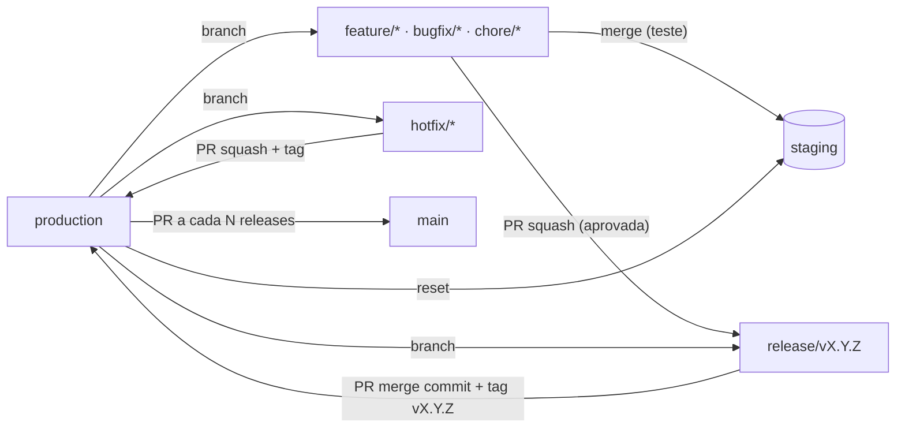

# GitFlow — Fluxo seguro com Release Branch Strategy

Convenção de fluxo Git para projetos que precisam de **rastreabilidade**, **controle do que vai para produção** e **entrega seletiva**: só as features aprovadas entram na release.

Plataforma de referência: **GitHub** (Rulesets, Environments, GitHub Actions). Os conceitos se aplicam a outras plataformas, mas os templates são para GitHub.

## Princípios

1. **Tudo nasce de `production`.** Branches de trabalho e releases partem sempre do que está no ar.
2. **`staging` é destino, nunca origem.** Recebe merges livres para teste, mas nunca é puxada para outra branch nem vira base de nada.
3. **Só o aprovado entra na release.** Cada feature aprovada vira **um commit** na `release/vX.Y.Z` (squash). As reprovadas não recebem PR.
4. **Produção muda só por PR.** `production` recebe apenas `release/vX.Y.Z` (merge commit) e `hotfix/*` (squash). Cada publicação ganha uma tag `vX.Y.Z`.
5. **`main` é o backup estável.** Só recebe PR de `production`, sempre numa versão publicada (com tag), a cada N releases (padrão 2). Nenhum outro caminho chega nela.
6. **Tudo é auditável.** Commits assinados, tags anotadas e atestação de proveniência dos pacotes.

## Branches permanentes

| Branch       | Papel                                                                 | Quem atualiza                                  |
|--------------|-----------------------------------------------------------------------|------------------------------------------------|
| `production` | Branch **principal**. Espelho do que está **em produção**; origem de todo o trabalho. | PR de `release/vX.Y.Z` (merge commit) ou `hotfix/*` (squash) |
| `staging`    | **Opcional.** Homologação integrada: várias features em teste ao mesmo tempo. | Merge livre de `feature/*`, `bugfix/*`, `chore/*`; resetada para `production` após cada publicação |
| `main`       | **Backup estável e seguro**: só versões publicadas.                  | PR de `production` a cada N releases (padrão 2) |

Quem não usa homologação simplesmente não cria `staging`: as features vão direto da revisão para a release.

A branch default do repositório não precisa mudar: nos PRs, informe sempre `--base`.

## Visão do fluxo

Ciclo resumido:

1. Desenvolvimento em `feature/*` criada a partir de `production`. Para atualizar: `git rebase origin/production`, nunca `staging`.
2. Teste: merge da feature em `staging` → deploy automático em homologação. QA aprova ou reprova cada feature.
3. O mantenedor cria `release/vX.Y.Z` a partir de `production`.
4. Cada feature aprovada abre PR para a release com **squash**. Reprovadas ficam de fora.
5. Validação final: `staging` é resetada para a release e passa por smoke test.
6. PR `release/vX.Y.Z → production` (merge commit). Após o merge, tag `vX.Y.Z` → build, atestação, GitHub Release e deploy em **produção**.
7. `staging` é resetada para `production`. A cada N releases publicadas (padrão 2), PR `production → main`.

Hotfix: `hotfix/*` nasce de `production`, vai por PR (squash) direto para `production`, recebe tag de patch e é levado para `staging` por cherry-pick.

O agente executa os passos do mantenedor por padrão (autorização gravada em `.claude/conventions.json`; `/conventions release off` revoga).

## Documentos

| Doc | Conteúdo |
|-----|----------|
| [01-branches.md](01-branches.md) | Branches permanentes, temporárias, origem/destino e nomenclatura |
| [02-commits.md](02-commits.md) | Mensagens de commit (Conventional Commits 1.0.0) e impacto na versão |
| [03-releases-e-tags.md](03-releases-e-tags.md) | Release seletiva, SemVer, publicação, hotfix, rollback |
| [04-seguranca.md](04-seguranca.md) | Rulesets, assinatura, Environments, hardening das Actions |
| [05-automacao.md](05-automacao.md) | Workflows, setup do repositório e comandos do dia a dia |
| [fluxo.html](fluxo.html) | Diagrama interativo do fluxo e do hotfix, com comandos e checklist de verificação |
| [templates/](https://github.com/uesleinasch/ConventionsCode/tree/main/GitFlow/templates) | Arquivos prontos para copiar para um projeto |

## Referências

- Conventional Branch: <https://conventionalbranch.org/pt-br/>
- Conventional Commits 1.0.0: <https://www.conventionalcommits.org/en/v1.0.0/#specification>
- Semantic Versioning 2.0.0: <https://semver.org/lang/pt-BR/>
