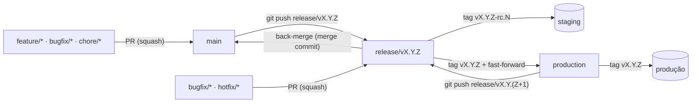

# GitFlow — Fluxo seguro com Release Branch Strategy

Convenção de fluxo Git para projetos que precisam de **rastreabilidade**, **controle do que vai para produção** e **automação baseada em tags**.

Plataforma de referência: **GitHub** (Rulesets, Environments, GitHub Actions). Os conceitos se aplicam a outras plataformas, mas os templates são para GitHub.

## Princípios

1. **Nada chega em produção sem passar por uma release versionada.** Produção só recebe código via tag `vX.Y.Z`.
2. **O que foi validado é exatamente o que é publicado.** A tag final aponta para o mesmo commit do último release candidate (RC) aprovado.
3. **Colaboradores abrem PRs; o mantenedor move refs protegidas.** `production`, `release/*` e tags `v*` são criados/atualizados só pelo mantenedor, com `git` e `gh`. Os workflows reagem às tags; não há bot nem GitHub App.
4. **A versão é derivada dos commits.** Conventional Commits → SemVer → changelog, sem edição manual.
5. **Tudo é auditável.** Commits assinados, tags anotadas e atestação de proveniência dos pacotes.

## Branches permanentes

| Branch       | Papel                                                                 | Quem atualiza                         |
|--------------|-----------------------------------------------------------------------|---------------------------------------|
| `main`       | Branch **default**. Integração e backup de todo o código desenvolvido. | PRs revisados (squash / back-merge)   |
| `production` | Espelho exato do que está **em produção**. Sempre igual a uma tag `vX.Y.Z`. | Somente o mantenedor, via fast-forward na promoção |

## Visão do fluxo

Ciclo resumido:

1. Desenvolvimento em `feature/*`, `bugfix/*`, `chore/*` → PR para `main` (squash, título em Conventional Commit).
2. O mantenedor calcula a próxima versão pelos commits (`git cliff --bumped-version`) e cria `release/vX.Y.Z` a partir de `main`.
3. Com o CI da release verde, o mantenedor cria a tag `vX.Y.Z-rc.N` → build do pacote → deploy em **staging**.
4. Correções da release entram por PR de `bugfix/*` direto na `release/vX.Y.Z` (novo RC a cada merge).
5. O mantenedor cria a tag `vX.Y.Z` no mesmo commit do último RC e faz fast-forward de `production` (`git push --atomic`).
6. A tag final dispara build, atestação, GitHub Release com changelog e deploy em **produção**.
7. Back-merge `release/vX.Y.Z` → `main` com `gh pr create` (merge commit) para levar as correções de volta.

Hotfix usa o **mesmo** fluxo, mas a release é cortada a partir de `production` com bump de patch.

## Documentos

| Doc | Conteúdo |
|-----|----------|
| [01-branches.md](01-branches.md) | Branches permanentes, tipos e nomenclatura (Conventional Branch) |
| [02-commits.md](02-commits.md) | Mensagens de commit (Conventional Commits 1.0.0) e impacto na versão |
| [03-releases-e-tags.md](03-releases-e-tags.md) | Release branch strategy, SemVer, RCs, promoção, hotfix |
| [04-seguranca.md](04-seguranca.md) | Rulesets, assinatura, Environments, hardening das Actions |
| [05-automacao.md](05-automacao.md) | Workflows, setup do repositório e checklist de adoção |
| [fluxo.html](fluxo.html) | Diagrama interativo do fluxo regular e do hotfix, com comandos e checklist de verificação |
| [templates/](https://github.com/uesleinasch/ConventionsCode/tree/main/GitFlow/templates) | Arquivos prontos para copiar para um projeto |

## Referências

- Conventional Branch: <https://conventionalbranch.org/pt-br/>
- Conventional Commits 1.0.0: <https://www.conventionalcommits.org/en/v1.0.0/#specification>
- Semantic Versioning 2.0.0: <https://semver.org/lang/pt-BR/>
